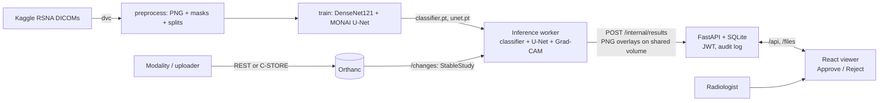

# Architecture

| Service | Port | Role |
|---|---|---|
| orthanc | 8042 (REST/UI), 4242 (DICOM) | Stores studies, emits `StableStudy` change events |
| worker | none | Polls Orthanc, runs models, posts result + writes overlay PNGs |
| api | 8000 | Study queue, decisions, append-only `audit_log`, OpenAPI at `/docs` |
| frontend | 3000 | Viewer with heatmap/mask overlays, confidence bar, banner |

Design choices worth defending in the presentation:
* **Shared preprocessing** (`src/data/dicom_utils.py`, `transforms.py`) is imported by training and inference, which prevents train/serve skew.
* **Audit log is append-only in the database itself** (SQLite triggers abort UPDATE/DELETE), and the confidence and model version are read server-side at decision time, never trusted from the browser.
* **Worker is idempotent**: persisted `/changes` cursor + processed set, API ignores duplicate study ids, failing studies retried 3 times then skipped.
* **Calibrated confidence**: temperature scaling fitted on the validation set; decision threshold chosen on validation (Youden J), never on test.
